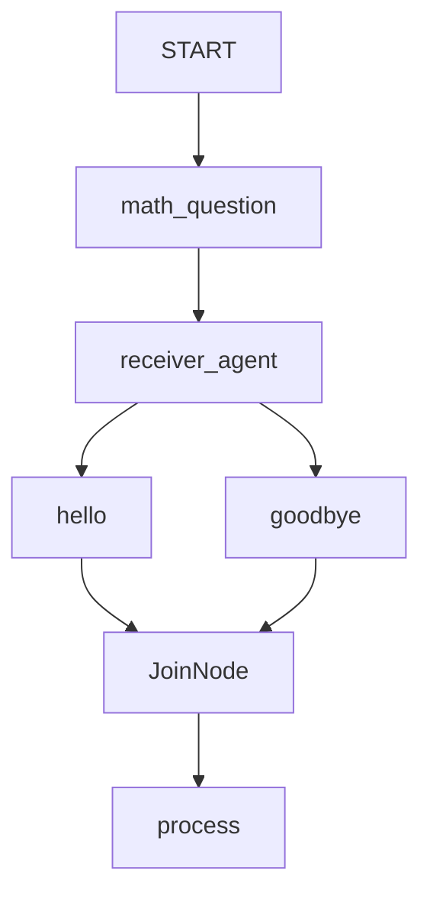

# Google ADK 入門到進階：依本專案實作

這份教學帶你從一個最小 Agent 開始，逐步讀懂本專案中的程式碼 Agent、設定檔 Agent、Workflow 與 MCP 工具。這裡的「進階」指本專案展示的組合方式，不代表涵蓋 Google ADK 的全部功能。

## 學習目標

完成閱讀後，你應該能夠：

- 說明 Agent 的模型、指令、描述與 `root_agent` 入口。
- 使用 ADK Runner、Session 和事件處理一次 Agent 執行。
- 看懂設定檔中的子 Agent 委派與工具註冊。
- 追蹤 Workflow 的節點、分支、狀態和 Join。
- 說明 ADK Agent 如何透過 MCP 呼叫外部工具。

## 0. 準備環境

本專案以 Python、Google ADK、LiteLLM、DeepSeek 和 FastMCP 為基礎。相依套件的固定版本記錄在 [`requirements.txt`](requirements.txt)。

在專案根目錄開啟 PowerShell：

```powershell
python --version
python -m venv .venv
.venv\Scripts\Activate.ps1
python -m pip install -r requirements.txt
```

設定 DeepSeek 金鑰與 API 位址。請使用環境變數，不要把金鑰寫進程式或提交到版本控制：

```powershell
$env:DEEPSEEK_API_KEY = "your_deepseek_api_key"
$env:DEEPSEEK_API_BASE = "https://api.deepseek.com"
```

`workflow_agent/agent.py` 會呼叫 `load_dotenv()` 讀取根目錄的 `.env`；`teacher_agent` 和 `mcp_agent` 不會自行載入 `.env`，因此建議在目前 shell 設定變數。

## 專案導覽

```text
teacher_agent/       Python Agent、Session、Runner 與事件處理
config_based_agent/  YAML Agent、子 Agent 與 Python 工具函式
workflow_agent/      以節點與邊組成的數學問答 Workflow
mcp_agent/           使用 MCP 工具集的 Agent 與獨立工具伺服器
```

各範例的重點：

| 範例 | 想學的概念 | 狀態 |
| --- | --- | --- |
| `teacher_agent` | Agent 定義、Session、Runner、事件 | 可用 ADK Web 啟動 |
| `config_based_agent` | YAML 設定、子 Agent、工具清單 | 展示設定；此資料夾沒有 Python loader 入口 |
| `workflow_agent` | 節點、圖邊、分支、狀態、Join | 可用 ADK Web 啟動 |
| `mcp_agent` | MCP stdio server 與遠端工具介接 | 可用 ADK Web 啟動 |

## 1. 基礎：建立一個 Agent

打開 [`teacher_agent/agent.py`](teacher_agent/agent.py)。核心物件如下：

```python
root_agent = Agent(
    name="TeacherAgent",
    instruction="...使用正體中文回答問題",
    description="...教授 React 的知識...",
    model=LiteLlm(model="deepseek/deepseek-flash"),
)
```

- `name` 是 Agent 的識別名稱。
- `instruction` 指示模型如何行動與回答。
- `description` 描述 Agent 的用途，對使用者或負責委派的 Agent 提供線索。
- `model` 指定模型。本例透過 `LiteLlm` 使用 DeepSeek 模型。
- `root_agent` 是 ADK 尋找應用入口時使用的慣例名稱。

此 Agent 除了 Agent 定義，也示範手動執行流程：

1. `InMemorySessionService` 建立記憶體中的 Session。
2. `Runner` 將 Agent 與 Session service 接起來。
3. `run_async()` 接收使用者訊息並回傳事件串流。
4. `async for` 讀取事件，再列印事件作者與文字內容。

Session 代表一次對話的工作階段。本例固定使用 `user_123` 和 `session_123`，適合示範；正式應用通常要依使用者與對話建立不同 ID，並選擇符合需求的持久化 Session service。

### 啟動

從專案根目錄執行：

```powershell
adk web teacher_agent
```

在 ADK Web UI 選取 Agent 後輸入 React 問題。Web UI 是本機開發介面，請勿暴露到不可信任的網路。

### 小實驗

修改 `instruction`，要求教師先問學生程度，再依程度調整解釋方式。比較修改前後的回答，觀察指令如何影響模型行為。

## 2. 設定檔：讓 Agent 委派工作與使用工具

[`config_based_agent/root_agent.yaml`](config_based_agent/root_agent.yaml) 將 Agent 定義放在 YAML 中。根 Agent 設定了模型與指令，並列出兩個子 Agent：

- `history_teacher.yaml`：回答歷史問題。
- `math_teacher.yaml`：回答數學問題。

根 Agent 的指令要求遇到數學或歷史問題時轉交適合的子 Agent。這就是多 Agent 組合的基本想法：由一個協調者判斷任務，再由專門 Agent 處理。

設定檔也註冊 [`config_based_agent/tools.py`](config_based_agent/tools.py) 中的函式：

- `greeting(name)`：產生問候語。
- `save_file(filepath, content)`：寫入檔案。
- `read_file(filepath)`：讀取檔案。
- `list_files(directory)`：列出目錄中的檔案。

這展示了「工具函式」與「子 Agent」兩種擴充方式：工具負責明確、可執行的操作；子 Agent 負責另一個模型任務或專業領域。

### 重要的專案限制

這個資料夾目前只有 YAML 和工具函式，沒有 Python 的設定載入器或獨立啟動入口；因此本教學將它視為設定格式範例，而不是可直接照其他資料夾執行的範例。設定中的路徑也依賴 Python 能匯入 `config_based_agent.tools`。

檔案工具目前接受呼叫者提供的路徑，沒有目錄白名單或權限檢查。不要把它直接暴露給不受信任的使用者；正式使用前應限制可讀寫目錄，並處理錯誤與覆寫政策。

### 小實驗

增加一個 `science_teacher.yaml`，在根 Agent 設定中登錄它，並更新協調指令。再想想：當請求同時涉及數學和歷史時，應該由根 Agent 選一個、依序委派，還是交給能協作的流程？

## 3. 進階：用 Workflow 表示有向流程

打開 [`workflow_agent/agent.py`](workflow_agent/agent.py)。它不只定義單一 Agent，而是把節點和邊組成 Workflow：



各節點的分工：

- `math_question` 是 `@node` 包裝的 Python 函式，從 `Context` 取得使用者內容並轉成大寫。
- `receiver_agent` 是數學教師 Agent，收到前一節點的輸入後生成回答。
- `hello` 與 `goodbye` 接收 Agent 輸出，分別存進 `ctx.state["hello_input"]` 和 `ctx.state["goodbye_input"]`。
- `JoinNode` 表示兩條分支匯合後才繼續。
- `process` 從 state 讀取兩個值並組成最後的字串。

在 Workflow 中，邊描述資料與控制流程；`Context` 提供節點執行時的上下文；`ctx.state` 可在節點之間保存資料。分支適合表達可同時進行或分別處理的工作，Join 則用於等待分支匯合。

### 目前程式的實際輸出

`hello` 和 `goodbye` 雖然各自回傳 `hello_done`、`goodbye_done`，但 `process` 並沒有讀取這兩個回傳值。它讀取的是兩個分支保存的 `node_input`，也就是 `receiver_agent` 傳來的內容。因此目前結果會把 Agent 的輸出放進 `Hello: ...` 與 `Goodbye: ...` 兩個欄位，而不是輸出兩個完成標記。

此外，最前面的 `math_question` 會把使用者輸入轉成大寫，再交給教師 Agent。這是流程示範，不一定是數學問答的理想前處理。

啟動方式：

```powershell
adk web workflow_agent
```

### 小實驗

讓 `process` 只輸出一次保存的回答，或讓兩個分支做不同的後處理並各自寫入 state。再測試移除其中一條通往 Join 的邊，觀察流程是否還能如預期完成。

## 4. 進階：透過 MCP 接上獨立工具伺服器

MCP 將工具提供者與使用工具的 Agent 分開。此專案把伺服器放在 [`mcp_agent/server.py`](mcp_agent/server.py)，把 Agent 與工具集設定放在 [`mcp_agent/agent.py`](mcp_agent/agent.py)。

伺服器端使用 FastMCP：

```python
mcp = FastMCP("My Awesome Server")

@mcp.tool()
def calculate_bmi(weight_kg: float, height_m: float) -> str:
    bmi = weight_kg / (height_m ** 2)
    return f"夥計，你的BMI 是 {bmi:.2f}"

mcp.run(transport="stdio")
```

`@mcp.tool()` 將 Python 函式註冊為 MCP 工具。伺服器使用 `stdio` 傳輸，因此由客戶端啟動子程序並透過標準輸入輸出溝通，不需要另開 HTTP port。

Agent 端透過 `McpToolset` 和 `StdioConnectionParams` 指定啟動方式：

```python
toolset = McpToolset(
    connection_params=StdioConnectionParams(
        server_params=StdioServerParameters(
            command="python",
            args=["mcp_agent\\server.py"],
        )
    )
)
```

接著把 `toolset` 放進 Agent 的 `tools`。模型會依照使用者請求決定是否呼叫工具；真正的 BMI 計算由 Python 函式完成，而不是交給模型心算。

啟動時請在專案根目錄執行，因為工具伺服器使用相對路徑：

```powershell
adk web mcp_agent
```

### 工具設計注意事項

目前 BMI 函式沒有檢查 `height_m` 是否為正數，因此輸入 0 會造成除以零。實作實際工具時，應在函式內驗證輸入並回報可理解的錯誤。BMI 是一般指標，不是醫療診斷或專業建議。

### 小實驗

新增一個純計算工具（例如攝氏轉華氏），用 `@mcp.tool()` 註冊，再將同一個 MCP toolset 提供給 Agent。比較工具呼叫與直接在 Agent 指令中要求模型估算的差異。

## 5. 執行與排錯

從專案根目錄啟動可直接執行的範例：

```powershell
adk web teacher_agent
adk web workflow_agent
adk web mcp_agent
```

- `ModuleNotFoundError`：確認虛擬環境已啟用，並重新安裝 `requirements.txt`。
- `401 Unauthorized`：檢查目前 PowerShell 工作階段的 `DEEPSEEK_API_KEY`。
- 模型或連線錯誤：確認模型名稱、`DEEPSEEK_API_BASE`、網路與供應商服務狀態。`teacher_agent` 和 `workflow_agent` 使用 `deepseek/deepseek-flash`；`mcp_agent` 使用 `deepseek/deepseek-chat`。
- MCP server 找不到：從專案根目錄啟動，確認 Python 虛擬環境已啟用，且 `mcp_agent/server.py` 可執行。
- `.env` 沒有生效：目前只有 Workflow 明確呼叫 `load_dotenv()`；其他範例請在 shell 設定環境變數。

## 6. 從範例走向自己的 Agent

建議依序實作以下改進：

1. 將固定的使用者與 Session ID 改為每次對話可區分的 ID，並評估持久化 Session。
2. 修整 Workflow，明確定義各節點輸入、輸出及 state 欄位，避免依賴不清楚的隱含資料傳遞。
3. 為工具加入輸入驗證、例外處理和存取限制。
4. 為常見問題建立測試，分別驗證工具函式、Agent 回應與整體流程。
5. 把敏感資訊放在環境變數或秘密管理服務，並限制開發用 Web UI 的網路存取。

這些練習會把本專案展示的核心模式串起來：Agent 負責推理與委派，Workflow 負責明確的控制流程，工具負責可驗證的操作，Session 負責對話脈絡。