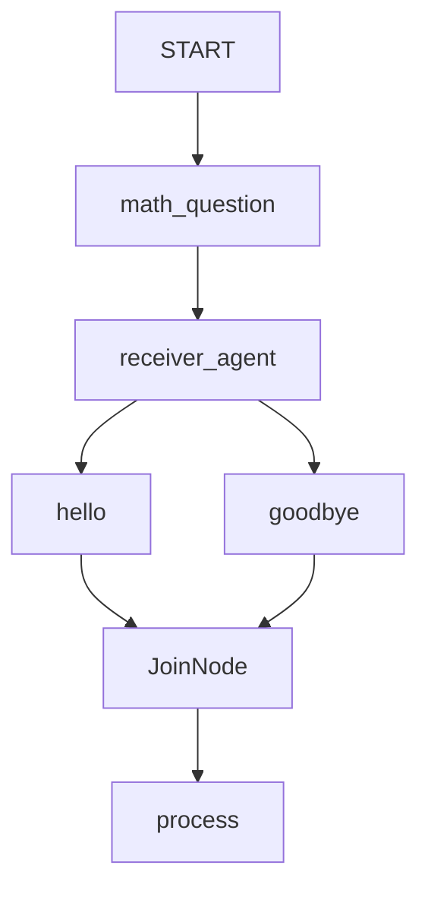

# Google ADK 教學範例

本專案以多個小應用介紹 Google ADK 的核心概念：單一 Agent、圖形化 Workflow，以及透過 MCP 呼叫外部工具。大部分範例使用 DeepSeek；`ollama_based_agent` 則示範透過 Ollama 在本機執行模型。

## 學習路線

1. 先執行 `teacher_agent`，認識 Agent 的角色指示、模型與 `root_agent` 入口。
2. 再讀 `workflow_agent`，了解如何把函式節點、Agent、分支和 Join 組成工作流。
3. 執行 `mcp_agent`，觀察 Agent 如何透過 MCP 工具集呼叫獨立的工具伺服器。
4. 想在本機執行模型時，試試 `ollama_based_agent`，了解如何透過 Ollama 的 OpenAI 相容 API 連接模型。

## 專案結構

```text
mcp_agent/
  agent.py       # 把 MCP 工具集接到健康管理 Agent
  server.py      # FastMCP stdio server，提供 calculate_bmi
ollama_based_agent/
  agent.py       # 透過 Ollama 本機模型回答中國古代史問題
  README.md      # Ollama 安裝、設定與執行說明
teacher_agent/
  agent.py       # React 教師 Agent
workflow_agent/
  agent.py       # 數學問答 Workflow
requirements.txt # 固定版本的相依套件
```

每個 ADK 應用都匯出名為 `root_agent` 的物件，讓 ADK CLI 能載入對應資料夾。

## 1. 建立執行環境

建議使用 Python 3.10 或更新版本。在專案根目錄建立虛擬環境並安裝鎖定版本的依賴：

```powershell
python --version
python -m venv .venv
.venv\Scripts\Activate.ps1
python -m pip install -r requirements.txt
```

`google-adk` 提供 Agent、Workflow 和 Web UI；`litellm` 讓 ADK 呼叫 DeepSeek 或 Ollama 的 OpenAI 相容 API；`python-dotenv` 供部分範例讀取 `.env`；`fastmcp` 和 MCP 相依套件用於工具伺服器。使用 `ollama_based_agent` 另外需要安裝並啟動 Ollama。

## 2. 設定模型金鑰

在 PowerShell 設定環境變數，該設定會套用到目前終端機工作階段：

```powershell
$env:DEEPSEEK_API_KEY = "your_deepseek_api_key"
$env:DEEPSEEK_API_BASE = "https://api.deepseek.com"
```

也可以在專案根目錄 `.env` 放入相同變數：

```env
DEEPSEEK_API_KEY=your_deepseek_api_key
DEEPSEEK_API_BASE=https://api.deepseek.com
```

目前只有 `workflow_agent/agent.py` 明確呼叫 `load_dotenv()`。`teacher_agent` 和 `mcp_agent` 不會自行載入 `.env`，使用它們時請先在 shell 設定環境變數。不要把 API 金鑰寫進程式碼或提交到版本控制。

### Ollama 本機模型

`ollama_based_agent` 不使用 DeepSeek API 金鑰，而是透過 Ollama 的 OpenAI 相容 API 連線。先安裝 Ollama，下載範例使用的 `llava:7b` 模型，並確保 Ollama 服務正在執行：

```powershell
ollama pull llava:7b
ollama serve
```

若 Ollama 已經在背景執行，就不需要再啟動 `ollama serve`。`ollama_based_agent/.env` 預設設定如下；本機 Ollama 不驗證 API key，因此 `OPENAI_API_KEY` 使用非空的佔位值即可：

```env
OPENAI_API_KEY=localhost-api
OPENAI_API_BASE=http://localhost:11434/v1
```

Agent 使用 LiteLLM 的 `openai/llava:7b` 模型名稱呼叫此端點；`openai/` 是 LiteLLM 的 provider 前綴，不代表請求會送往 OpenAI。更多設定與排錯方式請見 [`ollama_based_agent/README.md`](ollama_based_agent/README.md)。

## 3. 從單一 Agent 開始

閱讀 `teacher_agent/agent.py`。`Agent` 的幾個重要設定是：

- `name`：Agent 的識別名稱。
- `instruction`：告訴模型扮演什麼角色、如何回答；此範例設定為使用正體中文教授 React。
- `model`：由 `LiteLlm` 指定模型、API 金鑰與 API 位址；此範例使用 `deepseek/deepseek-chat`。
- `root_agent`：ADK CLI 載入應用時使用的入口物件。

啟動方式見下方「執行範例」。

## 4. 將節點組成 Workflow

閱讀 `workflow_agent/agent.py`。ADK `Workflow` 以 `edges` 描述節點之間的資料流程；`@node` 可將 Python 函式包裝成工作流節點，`Context` 則提供使用者內容和工作階段狀態。



在這個範例中，`math_question` 將使用者內容轉成大寫，接著由 `receiver_agent`（`deepseek/deepseek-flash`）回答。回答分流到 `hello` 和 `goodbye`，兩者分別寫入 state；`JoinNode` 等待兩條分支完成後，由 `process` 組合輸出。

**注意目前範例的輸出：**`hello` 和 `goodbye` 回傳的是 `hello_done`、`goodbye_done`，所以 `process` 組合的是這兩個完成標記，而非數學模型的回答。若要讓使用者看到答案，需另外把模型回答保存到 state，並讓 `process` 回傳該回答。

## 5. 透過 MCP 接入工具

閱讀 `mcp_agent/server.py` 和 `mcp_agent/agent.py`：

1. `server.py` 用 FastMCP 建立 MCP server，並以 `@mcp.tool()` 註冊 `calculate_bmi(weight_kg, height_m)`。
2. server 使用 `stdio` 傳輸，不需要另外開 HTTP port。
3. `agent.py` 透過 `McpToolset` 設定 server 啟動命令，並把工具交給健康管理 Agent。
4. 使用者提出 BMI 計算需求時，模型可判斷是否呼叫此工具。

BMI 僅是一般健康指標，不能取代醫療診斷或專業建議。

## 執行範例

在專案根目錄執行各自的命令：

```powershell
# React 教師 Agent
adk web teacher_agent
```

```powershell
# 數學 Workflow
adk web workflow_agent
```

```powershell
# 含 BMI MCP 工具的健康管理 Agent
adk web mcp_agent
```

```powershell
# Ollama 本機模型 Agent
adk web ollama_based_agent
```

直接執行 Ollama 範例也可以：

```powershell
python ollama_based_agent/agent.py
```

依終端機顯示的網址開啟 ADK Web UI。請從專案根目錄執行，因為 MCP Agent 使用相對路徑 `mcp_agent/server.py` 啟動工具伺服器。ADK Web 是未驗證的本機開發服務，請勿暴露在不可信任的網路上。

## 常見問題

- **找不到 `google.adk` 或 MCP 套件**：確認虛擬環境已啟用，並執行 `python -m pip install -r requirements.txt`。
- **401 Unauthorized**：確認 `DEEPSEEK_API_KEY` 有效，且目前 shell 已設定該變數。
- **模型名稱錯誤或不可用**：Workflow 使用 `deepseek/deepseek-flash`；教師與 MCP Agent 使用 `deepseek/deepseek-chat`。模型供應狀態可能變動，請同時檢查 DeepSeek 與 LiteLLM 的支援情況。
- **MCP 工具沒有啟動**：確認已啟用虛擬環境，並從專案根目錄執行 `adk web mcp_agent`，以確保 `python mcp_agent/server.py` 路徑有效。
- **API 連線錯誤**：確認網路、`DEEPSEEK_API_BASE`（`https://api.deepseek.com`）和服務狀態。
- **Ollama 連線失敗**：確認 Ollama 正在執行，且 `ollama_based_agent/.env` 的 `OPENAI_API_BASE` 指向 `http://localhost:11434/v1`。
- **Ollama 找不到模型**：執行 `ollama pull llava:7b`，並以 `ollama list` 確認模型已下載。